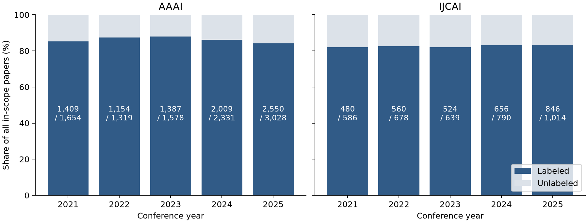

# Final quality sprint — 11 November 2026

Local implementation on frozen production graph `release-d3c788c3114a` at base
HEAD `5140ad8`. No graph replacement, source recollection, classifier retraining,
Neo4j write, push or deployment. Prior uncommitted Task2D identity changes excluded.

## Executive summary

The project now has a bounded, reproducible ten-relation AI audit, two ready-to-use
human packets, explicit topic-coverage context and more cautious bridge-ranking
interpretation. The sprint exposes uncertainty without rewriting frozen results.
Independent semantic accuracy and the course's 90% requirement remain unestablished.

## Implemented changes

| Area | Actual behavior / files |
| --- | --- |
| Audit | `quality/sprint_audit.py`: existing hash sampler, eight units/relation, witnesses, source-consistency rubric and versioned two-member HTML/CSV packets; strict complete-review joins |
| Evidence review | `luna-edges-1.jsonl`, `luna-edges-2.jsonl`, `luna-diagnostics.json`; actual `gpt-6-luna`, reasoning `high`, fresh contexts |
| Topic interpretation | Coverage figure and CSV reuse frozen analysis; no labels, thresholds, taxonomy, graph counts or historical metrics changed |
| Explorer | `AnalyticsView.tsx`, `lib/analytics.ts`: topic tooltip separates assigned count, labeled denominator and all-paper coverage; compact Task2C identity-sensitivity note |
| Research report | Existing `reports/final-report/report.md` updated in place with landscape/coverage, stratified audit, identity sensitivity and source links |
| Verification | Sampling/provenance and denominator regression cases; preservation and cached-object/locator checks |

## Targeted graph audit

See [edge-audit.md](edge-audit.md), [frozen sample](edge-sample.json),
[sampling manifest](sampling-manifest.json), [machine summary](quality-summary.json),
[flagged cases](issues.json), [actual reviewer output hashes](review-completion.json).
There are eight observations per relation. Two researcher-topic and one
organization-topic aggregates are AI-assessed unsupported; one authorship is
unknown. Other sampled claims receive supported judgments. These findings are
supplemental diagnostics, with **no pooled graph accuracy** or human metrics.
The coordinator checked the four flagged source packets. No graph edits followed.

Human packets: [member 1](human-member-1.html), [member 2](human-member-2.html),
matching CSVs and [allocation](human-allocation.json). Each shows the same 20
prespecified random cases, six existing risk diagnostics and all four cases from
the issue ledger. Three flagged cases overlap the random draw, so there are 27
unique cases per reviewer; each overlap keeps both tags. Only the random tag has
probability-based inclusion. Separate [post-blind diagnostic views for member 1](human-member-1-flagged-post-blind.html)
and [member 2](human-member-2-flagged-post-blind.html) contain Luna's concerns and
source locators; reviewers should export their initial judgments before opening
them. Human validation is **not performed**; both members' metrics are unavailable.

## Data-quality investigation

All seven DOI-disagreement cases were independently inspected by Luna against the
existing official/OpenAlex/Crossref evidence. The coordinator rechecked 14 Crossref
cache hashes/DOIs and five distinct official cache files. Same-title/byline journal
records suggest version consolidation but do not prove equivalence or authorize
historical affiliation transfer. **No new data correction is justified.**
The future-acquisition exact-DOI guard was already fixed in Task2B; focused tests
were rerun. Before/after production graph and metadata bytes are identical.
[Metadata verification](metadata-verification.json),
[prior fix and decisions](../quality-v5/task2b-v1/doi-reconciliation.md).

## Topic review and reliability

This is an eight-assignment, prediction-exposed **diagnostic**, not a blind test
or new F1 estimate. Luna finds clear privacy/robustness, graph-learning, RL and
multimodal matches, a likely omitted vision label on temporal-action localization,
an omitted multi-agent leaf, and a reasoning/optimization taxonomy boundary.
A separate edge reviewer supports all eight sampled HAS_TOPIC claims, including
the representation-learning assignment challenged by the diagnostic reviewer.
This difference is retained rather than adjudicated into gold. AI opinion and
classifier similarity scores cannot establish correct labels.

Examples: `paper:aaai:2024:28516` localizes actions in video but carries
representation learning; `paper:aaai:2021:17343` addresses multi-agent Q-learning;
`paper:ijcai:2023:215` concerns MaxSAT/hitting-set solvers. Full excerpts,
source locators and qualifications are in [Luna diagnostics](luna-diagnostics.json).
No synonym collapse, taxonomy remapping, threshold tuning or prediction changes
were justified. Before/after assignments and historical embedding/phrase F1
(.4667/.2301 against AI references) are unchanged.

Trust the **measured label inventories and declared denominators** as graph
facts; treat substantive topic prevalence, organizational portfolios and thresholded
researcher-topic profiles as provisional model interpretations. The graph has
11,575 labeled / 13,617 papers; 2,042 abstentions are not negative topic labels.



Coverage uses all included papers as denominator, while topic share uses labeled
papers and fractional 1/k credit across k labels. [CSV](figures/coverage.csv),
[analysis binding](figures/receipt.json). No classifier was rerun.

## Explorer and research findings

The existing layout, controls, hover labels, filters, evidence actions, animations
and saved workspaces are preserved. Tooltips now explicitly distinguish **raw
papers assigned this topic**, **labeled denominator**, **all papers** and coverage;
nonfinite percentages display unavailable. The bridge panel distinguishes the
Task2C identity-policy comparison from the existing base/strict support filter.

The existing frozen analysis shows 2,240 included papers in 2021 and 4,042 in
2025, with a 2022 dip. Multimodal share among labeled AAAI papers increases from
6.96% to 16.42%; IJCAI from 7.43% to 12.90%. Coverage and classifier errors limit
inference about the whole research field. Coauthorship has a large connected
component but many smaller components and isolates. Task2C candidate comparisons
retain 19–20/20 degree leaders against v4 while retaining only 11–12/20
betweenness leaders. Structural bridge screens need person-specific checking.
These are reused measured analyses, not independently verified identity findings.

## Validation and reproducibility

Final outcomes and commands: [validation.md](validation.md). The checked local
draft has **28 A4 pages**; [package receipt](package-receipt.json) binds the clean
`198e108` checkpoint and local PDF/ZIP paths. The clean snapshot also passes
635 Python tests with one skip, excluding unrelated Task2D edits.
[Preservation](preservation-verification.json) checks 1,040 protected files,
341 original OpenAlex objects and exact retained authorship/reference locators.
Raw cache equality establishes reproducibility, not provider correctness.

```bash
uv sync --locked --group dev --extra analysis --extra report
uv run pytest -q
uv run python -m scientific_network.quality.sprint_audit \
  --graph data/processed/release-graph-v4/graph.json \
  --works data/interim/release-v1/works.jsonl \
  --issues reports/final-quality-sprint/issues.json \
  --sampling-manifest reports/final-quality-sprint/sampling-manifest.json \
  --output reports/runs/sprint-audit-replay-NEW
uv run python -m scientific_network.quality.sprint_landscape \
  --analysis reports/release-v4/analysis.json \
  --output reports/runs/sprint-landscape-replay-NEW
uv run research-network validate \
  --input data/processed/release-graph-v4/graph.json \
  --config configs/quality-release-v1.yaml --require-size \
  --output reports/runs/sprint-structural-NEW.json
# Frontend working directory: apps/research-explorer/frontend
npm run build
npx playwright test --config playwright.contracts.config.ts
```

Replay reproduces all 80 frozen edge records. The original sample hash, random IDs,
conditional probability and six risk IDs are asserted unchanged; the manifest adds a hash-bound
flagged diagnostic subset and packet hashes. Packet layout includes original plain
abstracts directly; the actual review's original
packets and corrective abstract supplement are hash-bound in the sampling manifest.
Original large evidence packets/cache bytes stay ignored under the work-ID run
folder. Restore exact graph/works/cache hashes before rerunning; current API
responses are not replacements. Reviewer judgments cannot be regenerated by
structural automation: preserve the actual committed Luna ledgers and prompts.

## Remaining risks and submission readiness

1. **P0:** Independent identity/semantic accuracy remains unestablished; three
   topic-derived AI challenges and one identity uncertainty require qualified
   interpretation. No candidate or production graph is promoted by this sprint.
2. **P1:** Historical topic agreement is limited; strata of eight are too small
   for strong precision claims. Missing affiliations and topic abstentions can
   bias rankings and landscape views. All intervals omit evaluator/source error.
3. **P1:** Exact bridge identities are policy-sensitive. Full 511-case human review,
   source-corrected rebuilds and affiliation reconstruction stay out of scope.
4. Team names/IDs/contributions and course disclosure/access facts remain pending.
   The report is a checked local draft, not a completed submission.

## Live deployment status recheck — 11 November 2026

A read-only fetch of `https://scientific-network-explorer.pages.dev/` returned
HTTP 200. Its served AnalyticsView bundle
(`AnalyticsView-l2ZOnUQX.js`) contains the topic tooltip's assigned-paper,
labeled-denominator and all-paper coverage wording, plus the Task2C
identity-sensitivity note present in the current frontend source. This supersedes
the earlier sprint note that production still served the prior frontend for these
changes. The public bundle does not expose its source commit, so this confirms the
requested behavior is live without claiming commit-level deployment provenance.
No deployment was performed in this cleanup; the API and graph remain unchanged.
