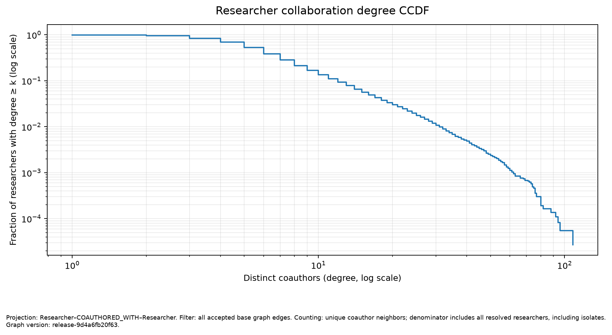
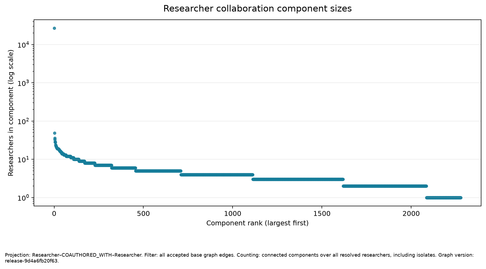
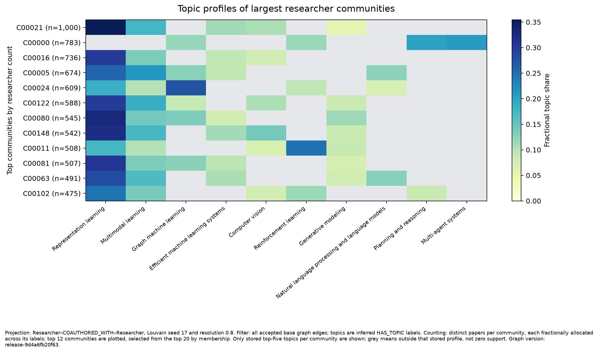
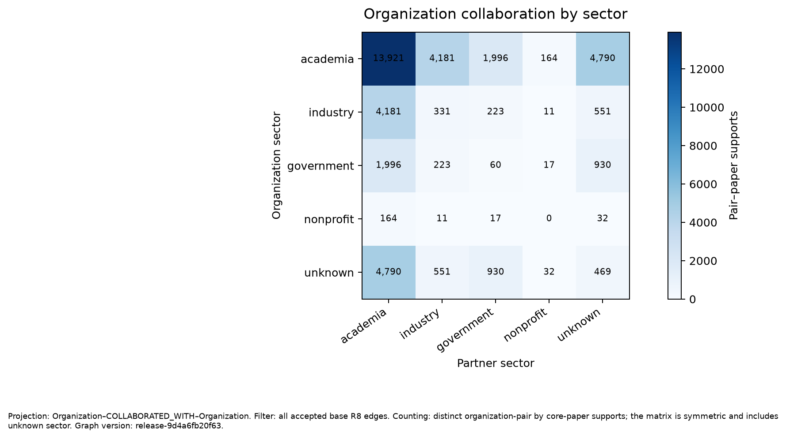
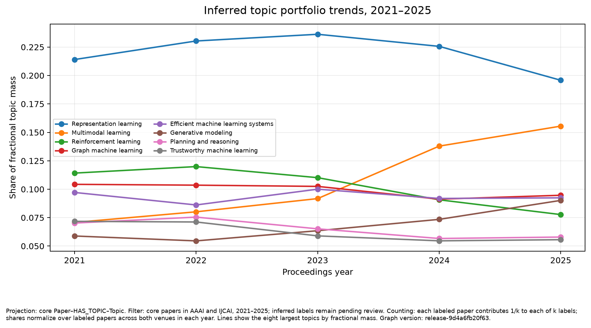
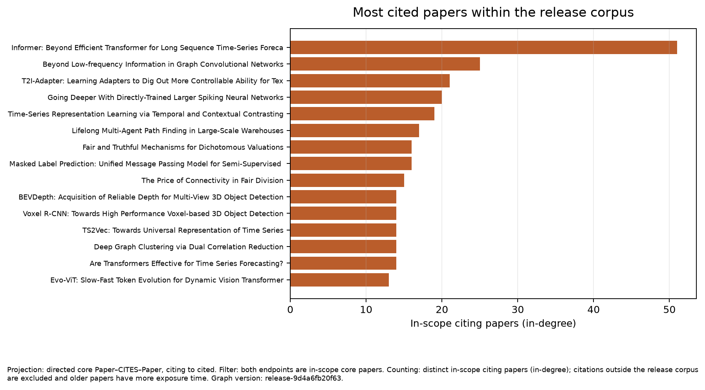

# AI Research Network: AAAI and IJCAI, 2021–2025

**Draft status:** methodology and Phase 6 results written. The user selected
agent-led evaluation on 9 November; evaluator implementation, source review and
scoring remain pending. Human annotations are optional. Real team details remain
pending from supplied records. This is not the final report.

## 1. Team allocation

**Pending completion from `docs/team.md`.** Names, student IDs, individual roles,
review assignments and course AI-use disclosure must be supplied from the team
record. They are intentionally not inferred here.

## 2. Network rationale

This project models the research relationships visible in main-track AAAI and
IJCAI proceedings from 2021 through 2025. The business questions are: (1) which
researcher groups and organizations repeatedly collaborate, and where do
academia–industry links appear within research topics; (2) which researchers
connect otherwise separate collaboration communities; and (3) how do
organization topic portfolios and within-corpus citation patterns differ over
time? These views can help a research-program analyst identify partnership
patterns for further investigation, find possible connectors between groups, and
compare the subject mix represented in this selected publication corpus.

The graph records publication evidence. It does not measure current employment,
nationality, contract value, commercial readiness, or causal influence. A bridge
score is a structural property of the configured projection and distance rule;
it is not an assessment of a person's quality or importance.

## 3. Data and software stack

The release uses the final roster-v10 inclusion decisions for AAAI and IJCAI
main-track papers in 2021–2025. It contains **13,617 core papers**: AAAI has
1,654, 1,319, 1,578, 2,331, and 3,028 papers by year; IJCAI has 586, 678, 639,
790, and 1,014. These are the two selected series in this release, not the full
five-year discovery registry. The broader roster collection records 98 eligible
editions and 91,355 included papers; 62 additional candidates remain unresolved
or unavailable. This release selects AAAI and IJCAI because their official
records supply DOI routes that OpenAlex returns in batches. The other editions
are a coverage limit, not missing release papers silently filled from another
source. See the [v10 recovery report](../five-year-source-recovery-v10.md).

The acquisition stage (`release-openalex-v1`) derives DOIs from official paper
URLs and queries OpenAlex in DOI batches, with singleton retries for missing
batch results. A work is matched only when title and byline counts meet the
release rules. It matched **13,606/13,617 (99.92%)**; 11 papers remain in review,
zero were reported not found, and all 13,606 matched works have abstracts. Two
matches carry a title-similarity flag. Source responses and manifests are
hash-bound in the acquisition report; raw cached responses remain local and
ignored.

The implementation uses Python 3.12, Pydantic graph contracts, NetworkX for
projection analysis, Matplotlib for static figures, and Neo4j Community 5.26 as
the graph DBMS. Topic representations use the frozen
`sentence-transformers/all-MiniLM-L6-v2` model revision recorded in the topic
configuration. Dependency versions are locked in `uv.lock`.

## 4. Preprocessing and identity resolution

Official roster records define the paper, venue, edition year, byline order and
publication URL. DOI derivation is venue-specific. OpenAlex works must agree on
normalized title (similarity threshold 0.9, with flagged near matches) and
author count. Unresolved or ambiguous matches remain in the review queue instead
of being forced into the graph. Duplicate DOI records are resolved with the
official landing-page rule where possible; nine duplicate-DOI cases remain in
review, alongside two author-count mismatches.

For a matched paper, a Researcher is keyed by its OpenAlex author ID only at a
compatible byline position. ORCID is recorded when present, but is not required
for this release. Names alone never merge people. The scoped roster has 65,507
author positions, including 38 on unmatched papers. Of the 65,469 positions on
matched works, **59,159** were accepted as `AUTHORED` support and **6,310** were
withheld: 6,283 lack an OpenAlex author ID, 7 have incompatible names, 18 are on
papers with a repeated author ID, and 2 otherwise compatible positions were
withheld because multiple mismatches affected their paper. Five papers have all
authorship positions withheld. The seven incompatible-name positions are 0.011%
of the official positions; missing author IDs are a separate and much larger
coverage limit.

Affiliation evidence is retained as author–paper–organization triples from the
matched OpenAlex authorship, with raw affiliation strings. The paper's full
institution list is not copied onto each author. There are **56,633 supported
author–paper positions** with institution evidence (95.73% of accepted
authorships). The paper-level copied-affiliation guard withheld 147 patterns.
`AFFILIATED_WITH` aggregates the accepted observations only after these
triples are retained.

Citation edges point from a citing paper to a deduplicated cited paper. The
acquisition scan found 378,360 reference targets: 370,831 targets outside the
release scope, 34 self-references, no ambiguous in-scope target mappings, and
7,308 accepted in-scope citation edges. External citations do not enter the
core citation projection.

## 5. NLP methods

The frozen topic taxonomy contains four parent topics and 16 leaf topics. A
phrase-based classifier supplied topics for graph v1. Graph v2 replaced those
labels with a sentence-embedding method using the frozen model revision and
development-calibrated thresholds `tau = 0.2708871365` and `delta = 0.02`.
The method compares title and abstract text against topic definitions and uses
an abstract sentence (or title for title-only text) as supporting evidence. It
assigns up to three leaf labels or abstains. Threshold calibration used
non-test papers; the test IDs were frozen before tuning. Model outputs were
generated only after the classifier freeze and are not shown in the prediction-blind
topic review sheet.

The corrected v3 graph has **11,575 topic-labeled papers** and **2,042 abstentions**, for
85.00% label coverage. This is coverage, not topic accuracy. Fifty frozen test
papers are ready for agent annotation with the 16 topic definitions.
Reviewer A and reviewer B each receive 30 papers, with 10 papers reviewed by
both; the union covers all 50. The allocation gives each reviewer 12 AAAI and 18
IJCAI papers. The hash-bound packets remain prediction-blind. Under the current
protocol A/B denote isolated evaluator contexts; the documented single-agent
variant is allowed when isolation is unavailable. No scored agent reference
labels or classifier precision/recall/F1 are available yet. Human validation is
not performed. Topic
trends and topic-based findings below are therefore provisional until those
annotations are scored.

## 6. Graph design and graph database

The property graph has five labels—Researcher, Paper, Organization, Topic and
Venue—and ten predicates. `AUTHORED`, `AFFILIATED_WITH`, `PUBLISHED_IN` and
`CITES` are observed facts; `HAS_TOPIC` is inferred from text; `SUBTOPIC_OF` is
curated taxonomy; `COAUTHORED_WITH`, `COLLABORATED_WITH`, `RESEARCHES_TOPIC` and
`CONTRIBUTES_TO_TOPIC` are derived from accepted core-paper support. Domain
nodes, evidence records and graph edges retain stable IDs and versioned
provenance. Unresolved evidence stays in review queues.

| Predicate | v3 edge count | Evidence class |
| --- | ---: | --- |
| AUTHORED | 59,159 | Observed |
| AFFILIATED_WITH | 44,535 | Observed |
| PUBLISHED_IN | 13,617 | Observed |
| CITES | 7,308 | Observed |
| HAS_TOPIC | 14,222 | Inferred topic |
| SUBTOPIC_OF | 16 | Curated taxonomy |
| COAUTHORED_WITH | 112,042 | Derived |
| COLLABORATED_WITH | 15,157 | Derived |
| RESEARCHES_TOPIC | 6,888 | Derived |
| CONTRIBUTES_TO_TOPIC | 2,494 | Derived |

The corrected frozen v3 graph (`release-9d4a6fb20f63`) has **52,415 nodes** and **275,438
edges**. The four observed predicates contain **124,619 unique factual edges**;
derived, inferred-topic and curated-taxonomy edges are counted separately.
Neo4j Community 5.26 was loaded in the isolated `neo4j-five-year` service on
`bolt://localhost:7689`. Fresh inventory and all six integrity queries passed for the corrected v3 graph;
replay reconciled counts without changing its inventory. The pilot and
extended databases were preserved.

## 7. Network statistics

Analysis uses separate researcher collaboration, organization collaboration,
core citation, paper-topic and organization-topic projections. Collaboration
edges are undirected, stored once in canonical endpoint order, and carry
fractional strength; weighted shortest-path distance is its inverse. Citation
edges remain directed, citing to cited. Topic portfolios fractionally allocate
each labeled paper across its accepted labels; organization portfolios also
divide a paper's contribution across its supported organizations.

The researcher projection contains **36,680 resolved researchers**,
**112,042 distinct coauthor pairs**, 193 isolates and 2,278 connected components.
The largest component contains **26,990 researchers (73.6%)**. Mean distinct
degree is 6.11 and the maximum is 108. Annual paper and active-researcher counts
are in the analysis JSON. New collaboration pairs are assigned to the earliest
year among their supported core papers, so yearly pair counts describe first
observed in-scope collaboration rather than an annual snapshot graph.

Sector and country mixing count distinct accepted organization-pair by
core-paper supports, using the derived collaboration evidence. Unknown sector
or country is retained as its own category. Topic shares are available by both
venue and year; topic figure trends combine venues within a year and normalize
over labeled papers. The directed citation projection contains 7,308 in-scope
edges; its highest in-degree paper has 51 in-scope citing papers. Raw citation
counts are not adjusted for the unequal time papers have had to receive
citations.

The six static figures and their CSV data tables are in
[`figures-v3/`](figures-v3/), with graph version, projection, filter and counting
conventions in each caption. Three source-linked candidate findings and two
screening shortlists are in
[`reports/release-v2/findings.md`](../release-v2/findings.md). The strict-filter
sensitivity analysis materially changes researcher betweenness rankings and
retains only 8.0% of researcher collaboration edges; these comparisons are
robustness diagnostics, not semantic accuracy estimates.

### Figures



*Figure 1. Researcher collaboration degree CCDF. Distinct coauthor neighbors;
denominator includes all resolved researchers, including isolates. Graph
`release-9d4a6fb20f63`.*



*Figure 2. Connected researcher collaboration components, ranked by size. All
resolved researchers are included, so isolates are size-one components. Graph
`release-9d4a6fb20f63`.*



*Figure 3. Top researcher communities under Louvain seed 17 and resolution 0.8.
Each distinct labeled paper is fractionally allocated over its inferred topics.
Only stored top-five topics per community are shown; grey cells indicate topics
outside that stored profile, not measured zero support. Topic labels await agent
review. Graph `release-9d4a6fb20f63`.*



*Figure 4. Organization collaboration sector mixing. Counts are distinct
organization-pair by core-paper supports on accepted `COLLABORATED_WITH` edges;
unknown sector remains visible. Graph `release-9d4a6fb20f63`.*



*Figure 5. Topic portfolio trends in 2021–2025. Each labeled paper contributes
fractionally across its accepted inferred labels; the series combine AAAI and
IJCAI within each year. Topic labels await agent review. Graph
`release-9d4a6fb20f63`.*



*Figure 6. Highest in-degree papers in the directed core citation projection.
Counts include only citing papers inside the release corpus and are not adjusted
for citation exposure time. Graph `release-9d4a6fb20f63`.*

## 8. Analysis and business findings

The collaboration network is highly connected at its largest scale but still
contains many small components: the largest component holds 73.6% of resolved
researchers, alongside 2,277 smaller components and 193 isolates. The unweighted
degree maximum is 108 distinct coauthors. This supports studying cross-group
connectors, while the small components caution against treating the graph as one
complete social system.

The sector matrix records 4,181 accepted academia–industry pair–paper supports.
The most frequent pair/topic candidate is Shanghai Jiao Tong University with
Tencent (China) in inferred Representation learning, supported by 14 distinct
core papers. Examples are [*Exploiting Fine-Grained Face Forgery Clues via
Progressive Enhancement Learning* (AAAI 2022)](https://doi.org/10.1609/aaai.v36i1.19954)
and [*DIRL: Domain-Invariant Representation Learning for Generalizable Semantic
Segmentation* (AAAI 2022)](https://doi.org/10.1609/aaai.v36i3.20193). This records
co-publication support in the selected corpus. It does not establish a present
partnership, commercial transaction or current employee relationship.

In the researcher projection, Dacheng Tao is the highest approximate-betweenness
candidate: score 0.05493 among 36,680 resolved researchers. The configured
Louvain community has 466 members and 231 distinct papers, 212 of which carry
inferred topics. Representation learning is the largest profile with 63 papers
and 23.6% of fractional topic mass. Supporting works include [*BESA:
BERT-based Simulated Annealing for Adversarial Text Attacks* (IJCAI
2021)](https://doi.org/10.24963/ijcai.2021/453) and [*Deep Graph-neighbor
Coherence Preserving Network for Unsupervised Cross-modal Hashing* (AAAI
2021)](https://doi.org/10.1609/aaai.v35i5.16592). Because the top-20 betweenness
overlap falls to 1/20 under the strict evidence filter and the rank correlation
is 0.275, this candidate is a lead for manual review rather than a stable
individual ranking.

For the inferred Representation learning topic, Zhejiang University has 171
R10-supported papers among 527 organization-associated topic-labeled papers;
Peking University has 149 among 420. Their fractional portfolio shares are
26.0% and 28.5%, respectively. Examples include Zhejiang University's
[*Multi-Scale Spatial Temporal Graph Convolutional Network for Skeleton-Based
Action Recognition* (AAAI 2021)](https://doi.org/10.1609/aaai.v35i2.16197) and
[*Generalizable Representation Learning for Mixture Domain Face Anti-Spoofing*
(AAAI 2021)](https://doi.org/10.1609/aaai.v35i2.16199); and Peking University's
[*Community-Aware Multi-Task Transportation Demand Prediction* (AAAI
2021)](https://doi.org/10.1609/aaai.v35i1.16107) and [*GRASP: Generic Framework
for Health Status Representation Learning Based on Incorporating Knowledge from
Similar Patients* (AAAI 2021)](https://doi.org/10.1609/aaai.v35i1.16152). These
denominators cover only accepted organization evidence in the topic-labeled
graph, not the organizations' complete research portfolios.

For investigation, the partner shortlist uses a threshold of at least eight
accepted pair–paper supports within one inferred topic. The leading candidates
are Shanghai Jiao Tong University–Tencent (14, Representation learning), Xiamen
University–Tencent (14, Representation learning), Zhejiang University–Alibaba
Group (14, Representation learning), Zhejiang University–Alibaba Group (13,
Multimodal learning), and Tsinghua University–Tencent (11, Representation
learning). This is a manual evidence-review queue, not a ranking of commercial
opportunity.

The bridge shortlist contains the top ten approximate-betweenness candidates
from the full researcher projection, including Dacheng Tao, Zhe Chen, Xiaochun
Cao, Shirui Pan and Xinchao Wang. The full list, scores and community IDs are in
[`findings.md`](../release-v2/findings.md). Selection requires a high configured
betweenness score with deterministic score/ID ordering; candidates should be
rechecked against accepted bylines and the strict-filter graph before use.

The within-corpus citation projection identifies *Informer: Beyond Efficient
Transformer for Long Sequence Time-Series Forecasting* (AAAI 2021) as the most
cited included target, with 51 in-scope citing papers. This is a count in the
captured OpenAlex snapshot. The graph omits out-of-scope citations, and the 2021
paper has more time to accumulate references than 2025 papers. PageRank and
in-degree rankings are descriptive and do not establish general scientific
impact.

## 9. Quality and robustness

The structural and coverage measurements currently available are:

| Measure | Observed | Interpretation |
| --- | ---: | --- |
| Domain nodes | 52,415 | Size gate passed (minimum 2,000) |
| Resolved core researchers | 36,680 | Size gate passed (minimum 2,000) |
| Unique R1–R4 factual edges | 124,619 | Size gate passed (minimum 5,000) |
| Nonempty relation types | 10/10 | Size gate passed |
| Matched works | 13,606/13,617 (99.92%) | 11 in review |
| Abstracts on matched works | 13,606/13,617 (99.92%) | Metadata coverage, not accuracy |
| Institution support on accepted authorships | 56,633/59,159 (95.73%) | Alignment coverage, not affiliation correctness |
| Topic labels | 11,575/13,617 (85.00%) | Coverage only; agent reference labels and scoring pending |

No independent semantic accuracy or AI-assessed precision has been measured.
The user has selected source-backed agent evaluation; human annotation is optional.
Evaluator provenance/receipt/ledger support must be implemented before the real
review. Old packets/receipts stay preserved; new agent artifacts use a separate
evaluation package without changing the graph, classifier, tests or thresholds.
The default edge sampling recipe
uses 200 edges sampled uniformly from the complete frozen edge frame, plus 10
per relation for separate relation-level inspection. The global sample has 50
edges reviewed by isolated evaluator channels A and B; remaining rows are split
evenly. The preserved packet has 300 unique sampled edges and 350 assigned rows.
Once labels and any adjudications are produced, the agent-aware scorer will report
global `k/n`, AI-assessed precision and the Wilson 95% interval, separate
per-relation counts, overlap agreement,
Cohen's kappa and error categories. Unverifiable edges count as incorrect.
**These fields remain pending; the generated packet is not an audit result.**

The topic test contains 50 held-out papers selected before threshold tuning,
with 20 AAAI and 30 IJCAI papers. Following the user's allocation decision,
reviewer A and reviewer B each receive 30 papers, with 10 shared and 50 unique
papers covered in 60 judgments. Each packet has 12 AAAI and 18 IJCAI papers. The
assignment method, test/master hashes and reviewer-sheet hashes are recorded in
the graph/source freeze record. The master sheet remains unchanged. After blind
agent labels are frozen, both the embedding classifier and phrase baseline will
be scored against the same AI-assigned reference labels for micro/macro precision,
recall, F1, coverage and labeler agreement. Every paper contributes total weight one to model metrics;
each of two judgments on a shared paper contributes one half. Reviewer
disagreements remain visible instead of being converted into a software-generated
consensus label, and agreement is measured only on the ten shared papers. When
isolated contexts are unavailable, the predeclared single-agent variant labels
each test paper once and reports no overlap agreement. Unreviewable evidence is
separate from a considered empty topic set, with actual denominators disclosed.

Results will explicitly identify AI evaluator/model/run provenance, source reuse
and evidence depth. Separate agent contexts do not establish independent gold
labels. Numeric course/project threshold comparisons are AI-assessed only;
verified course accuracy remains not established. Wilson intervals describe
sampling uncertainty conditional on supplied judgments and do not include
evaluator error, shared-model bias or correlated decisions. No claim is made
that the lecturer has accepted AI-only evaluation.

The frozen strict-evidence filter retains 8.0% of researcher-collaboration
edges, 27.4% of organization-collaboration edges, no citation or paper-topic
edges, and all organization-topic edges. This is a sensitivity comparison,
not a correctness estimate. In particular, the low researcher betweenness
overlap means bridge rankings are sensitive to evidence support. Topic coverage
is uneven by venue–year (81.9%–87.9%) and semantic topic validity is unmeasured.
No project precision gate or course accuracy requirement is declared passed.

## 10. Achievements and limitations

The release graph meets the course's node, factual-edge and ten-relation size
requirements, and it has passed structural validation, Neo4j inventory/integrity
checks and idempotent replay. Phase 6 now provides separate collaboration,
citation and topic projections, annual counts, partner/country mixing, topic
profiles, cited-paper rankings, sensitivity results, six figures and evidence
candidates. These are reproducible descriptions of the frozen artifact.

Several quality questions remain open. Eleven roster papers were not matched to
OpenAlex under the release rules. Thousands of official byline positions lack an
OpenAlex author ID and are withheld, so the researcher graph is a covered subset
of bylines rather than a complete author network. Agent evaluators have
not yet checked accepted identities, affiliations, citations, topics or derived
edges. The 85.0% topic coverage is not topic accuracy. Country and sector
properties describe normalized organization metadata rather than researchers'
nationality or employment. Citation counts have unequal exposure time. The
release covers two conference series only, so claims do not generalize to all AI
research venues.

The current graph and report are not certified for the assignment's >90% accuracy
claim. The final conclusion must state the measured Wilson interval and topic
evaluation after agent judgments are scored, identify the AI basis and evaluator
limitations, and report any failed numeric gate without claiming human validation.

The pre-audit correction synchronizes all Topic metadata, hierarchy and evidence
with the frozen classifier taxonomy; the classifier, test membership, predictions,
excerpts, similarity scores, core facts and derived weights are unchanged.
[The correction summary](../release-v2/graph-summary.json) records equality hashes.
All analysis and figures in this draft were freshly computed on the corrected
graph. Exact fractional accumulation (`d040-release-metrics-v2`) also corrects
floating-point order effects on tied community topic rankings; this changes no
graph facts or predictions. The old freeze and figure directory remain historical.
Execution follows [the agent workflow](../../docs/agent-audit-workflow.md).

## 11. Reproducibility and release state

The source repository is [HSandz/scientific-network](https://github.com/HSandz/scientific-network).
WORK-037 recorded an earlier 9 November remote check at `951b9c5`, with no tags;
remote state was not refreshed for this protocol amendment. Verify current refs
before separately authorized delivery. The course release/submission remains
pending in project records. This amendment performs no external delivery.
The frozen graph is
`release-9d4a6fb20f63`, SHA-256
`c23ef82c97fcb539b4b1c279e8ff42378bdb102e80fe851acf1a42e816a727b8`; the
release, quality, analysis and topic configuration hashes and review packet
hashes are recorded in [`freeze-v3.json`](../release-v2/freeze-v3.json).

The locked environment is restored with:

```bash
uv sync --locked --group dev --extra analysis
```

The frozen graph analysis is reproduced with:

```bash
uv run research-network analyze \
  --input data/processed/release-graph-v3/graph.json \
  --config configs/analysis-release-v1.yaml \
  --quality-config configs/quality-release-v1.yaml \
  --output reports/runs/manual-corrected-analysis.json
```

The committed fresh analysis is `reports/release-v2/analysis.json`. Use an unused
output path for each replay; do not overwrite the frozen analysis or graph. Source acquisition uses the official
roster manifest and OpenAlex cache described in `configs/release-v1.yaml`, with
an API key supplied via an ignored environment file. Raw downloads, graph JSON,
database volumes and paper files are not tracked in Git. The work logs record
the exact commands, input hashes, outcomes and local artifact paths for the
release stages. Independent reproduction should use the frozen configs and
confirm graph and summary hashes before comparing reports.

## Remaining completion work

The agent will implement the evaluator metadata/binding support, perform source
review, score the judgments, finish results/limitations and prepare the local
PDF/package. Human annotations are optional and are not a prerequisite. Real team
identities, student IDs, actual contributions and course-specific disclosure/access
facts must come from supplied records; missing values remain explicitly pending
without blocking other work. No accuracy claim is made in this draft.
