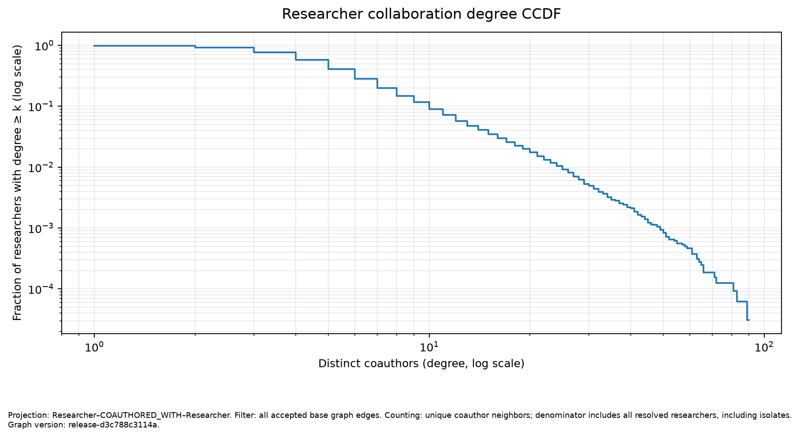
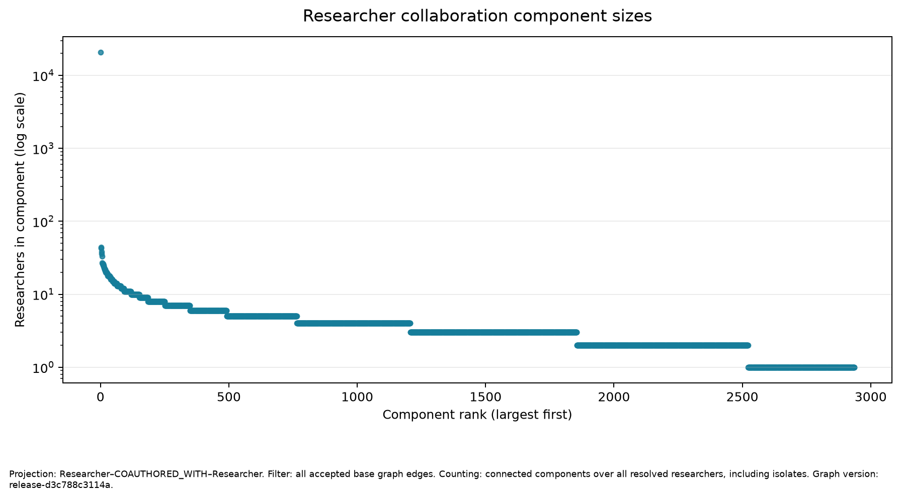
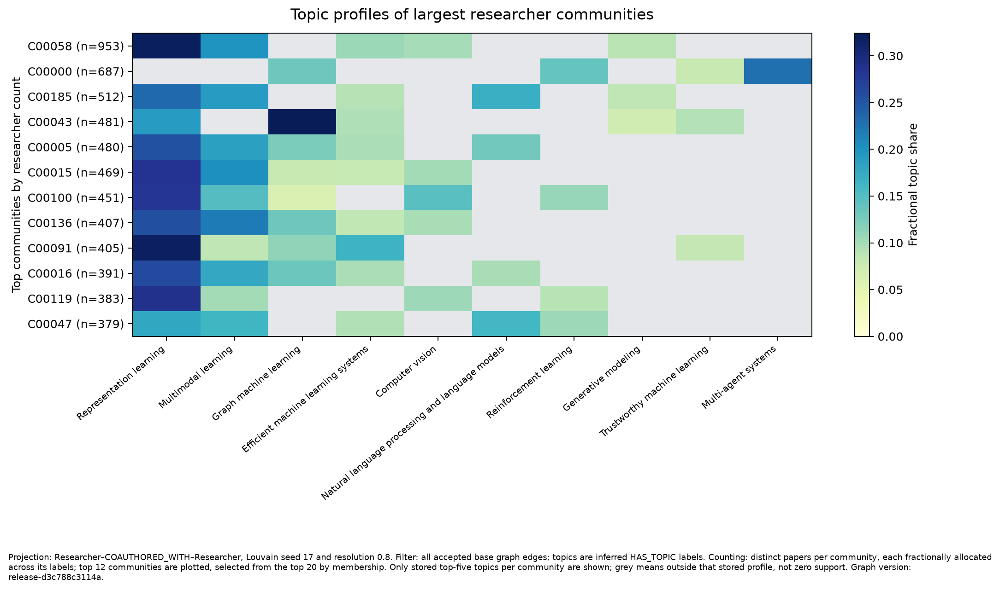
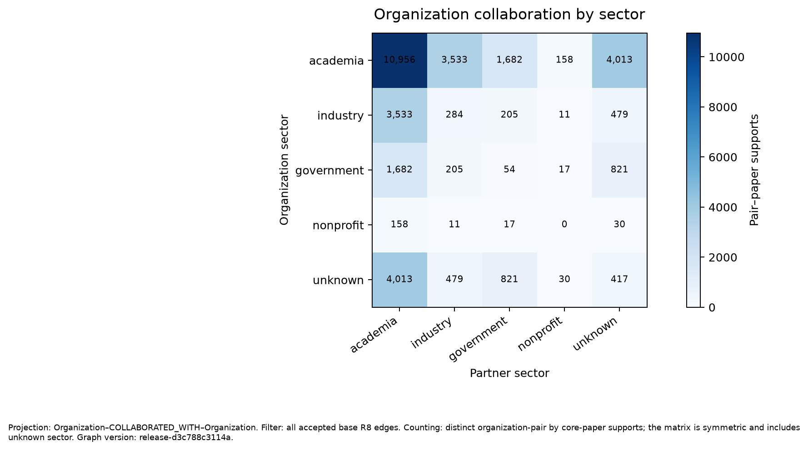
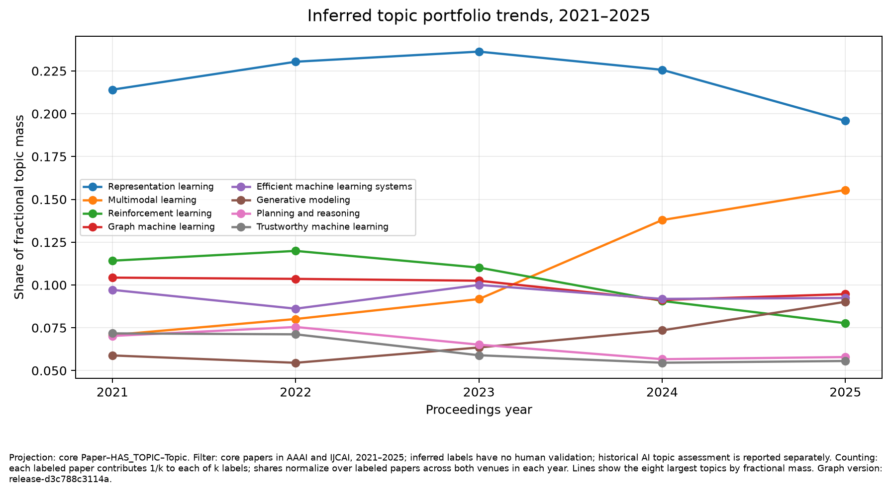
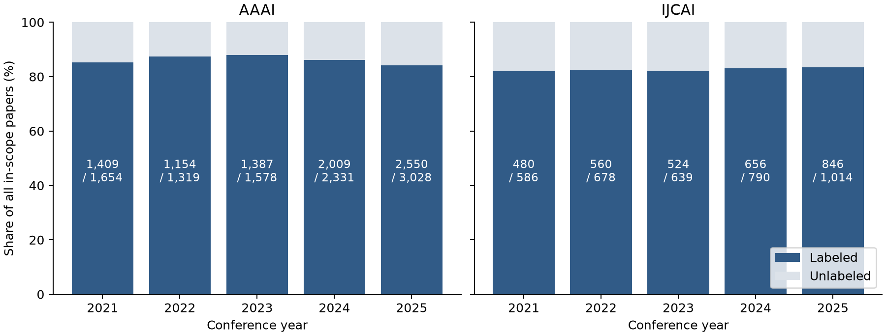
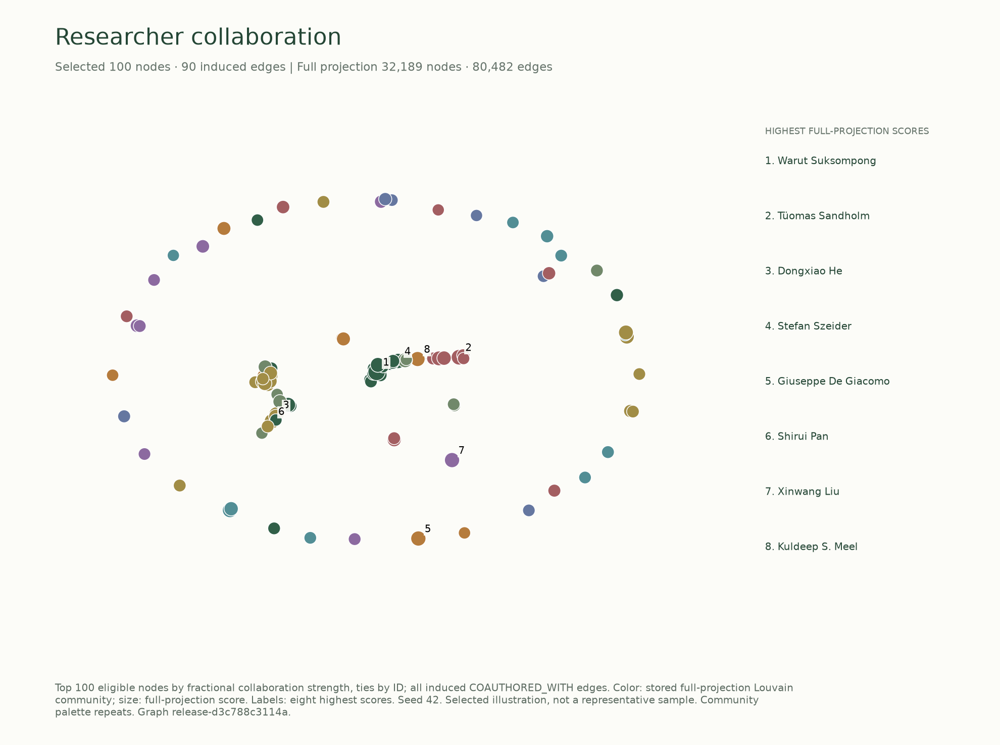
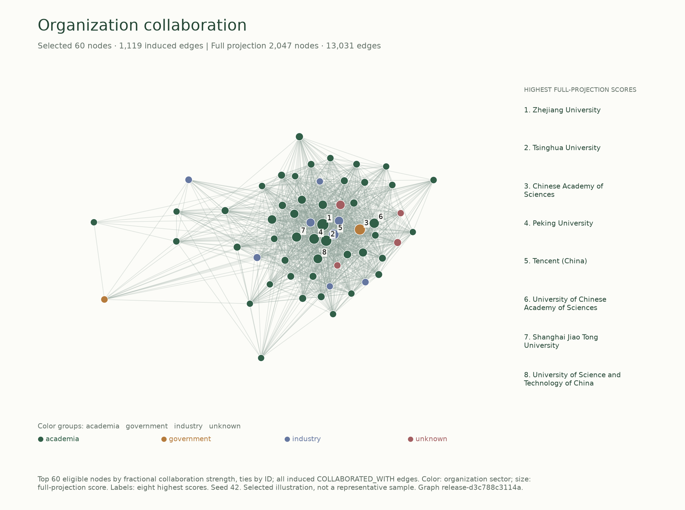
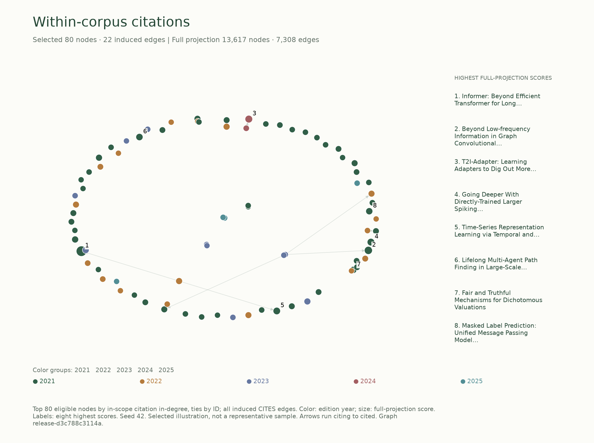

# AI Research Network: AAAI and IJCAI, 2021–2025

**Local report, updated 11 November 2026 — separately corrected graph v4.** The graph
contains **47,875 nodes and 225,731 edges**. Its one prospective source-backed
AI edge audit scores **193/200 = 96.50%, Wilson 95% 92.95%–98.29%**. The frozen
point/Wilson numeric checks pass **within AI assessment only**; this does not
establish independently verified course accuracy.
The preserved v3 audit scored **176/200 (88.00%), Wilson 95% 82.77%–91.80%** and
failed the course point and project precision checks. Affiliation coverage is
**48,259/65,469 matched author positions (73.71%)**, below the 80% target.
Historical AI-reference topic F1 remains **.4667/.2301** (embedding/phrase).
Human validation was not performed; evaluator independence and verified course
accuracy are not established. Real team details and course disclosure/access
facts remain pending. This local draft has not been published or submitted.

The [11 November quality sprint](../final-quality-sprint/README.md) adds a small
ten-relation Luna audit, coverage context and identity-sensitivity interpretation.
It changes no frozen graph, classifier or historical audit result.

## 1. Team allocation

Real human names, student IDs and actual human contributions remain **pending**
in [the team record](../../docs/team.md); no student identity is inferred from
repository accounts or illustrative role assignments.

| Recorded contributor | Actual work in this execution | Attribution scope |
| --- | --- | --- |
| Codex coordinator | Repository inspection, evaluator freeze, integration, validation, scoring/report/package preparation | AI-assisted project work |
| Historical isolated evaluator A | 30 blind topic judgments; assigned v3 edge review | AI evaluator channel, not a student |
| Historical isolated evaluator B | 30 blind topic judgments; assigned v3 edge review | AI evaluator channel, not a student |
| Prospective evaluator A (`/root/prospective_a`) | 175 assigned v4 edge judgments in a fresh context | AI evaluator channel; no new topic references |
| Prospective evaluator B (`/root/prospective_b`) | 175 assigned v4 edge judgments in a separate fresh context | AI evaluator channel; no new topic references |
| Scorer/renderer agent | Provenance-bound evaluation wrapper, regression tests and local rendering/package tooling | AI-assisted implementation |
| Human team | Names, IDs and actual individual contributions pending | Must be supplied from real records |

The contexts use the platform's inherited settings; precise provider/model/version
and sampling parameters are not exposed and are recorded as unknown. Historical A/B received
no inherited coordinator conversation or other evaluator answers. The new edge-only
audit uses its own recorded evaluator runs and does not attribute historical topic
judgments to those new runs. The course's
specific AI-use disclosure/access requirements remain pending; this report openly
identifies AI work without asserting lecturer acceptance of AI-only judging.

## 2. Network rationale

This project models the research relationships visible in main-track AAAI and
IJCAI proceedings from 2021 through 2025. The business questions are: (1) which
researcher groups and organizations repeatedly collaborate, and where do
academia–industry links appear within research topics; (2) which researchers
connect otherwise separate collaboration communities; and (3) how do
organization topic portfolios and within-corpus citation patterns differ over
time? These views can help a research-program analyst identify partnership
patterns for further investigation, find possible connectors between groups, and
compare the subject mix represented in this selected publication corpus.

The graph records publication evidence. It does not measure current employment,
nationality, contract value, commercial readiness, or causal influence. A bridge
score is a structural property of the configured projection and distance rule;
it is not an assessment of a person's quality or importance.

## 3. Data and software stack

The release uses the final roster-v10 inclusion decisions for AAAI and IJCAI
main-track papers in 2021–2025. It contains **13,617 core papers**: AAAI has
1,654, 1,319, 1,578, 2,331, and 3,028 papers by year; IJCAI has 586, 678, 639,
790, and 1,014. These are the two selected series in this release, not the full
five-year discovery registry. The broader roster collection records 98 eligible
editions and 91,355 included papers; 62 additional candidates remain unresolved
or unavailable. This release selects AAAI and IJCAI because their official
records supply DOI routes that OpenAlex returns in batches. The other editions
are a coverage limit, not missing release papers silently filled from another
source. See the [v10 recovery report](../five-year-source-recovery-v10.md).

The acquisition stage (`release-openalex-v1`) derives DOIs from official paper
URLs and queries OpenAlex in DOI batches, with singleton retries for missing
batch results. A work is matched only when title and byline counts meet the
release rules. It matched **13,606/13,617 (99.92%)**; 11 papers remain in review,
zero were reported not found, and all 13,606 matched works have abstracts. Two
matches carry a title-similarity flag. Source responses and manifests are
hash-bound in the acquisition report; raw cached responses remain local and
ignored.

The implementation uses Python 3.12, Pydantic graph contracts, NetworkX for
projection analysis, Matplotlib for static figures, and Neo4j Community 5.26 as
the graph DBMS. Topic representations use the frozen
`sentence-transformers/all-MiniLM-L6-v2` model revision recorded in the topic
configuration. Dependency versions are locked in `uv.lock`.

## 4. Preprocessing and identity resolution

Official roster records define the paper, venue, edition year, byline order and
publication URL. DOI derivation is venue-specific. OpenAlex works must agree on
normalized title (similarity threshold 0.9, with flagged near matches) and
author count. Unresolved or ambiguous matches remain in the review queue instead
of being forced into the graph. Duplicate DOI records are resolved with the
official landing-page rule where possible; nine duplicate-DOI cases remain in
review, alongside two author-count mismatches.

For a matched paper, a Researcher is keyed by its OpenAlex author ID only at a
compatible byline position. ORCID is recorded when present, but is not required.
Names alone never merge people. The scoped roster has **65,507 official author
positions**, including 38 on unmatched papers. Of **65,469 matched positions**,
the corrected graph accepts **50,437 AUTHORED edges** and withholds **15,032**.
The historical builder withheld 6,310 positions: 6,283 without an OpenAlex author
ID, 7 with incompatible names, 18 on papers with a repeated ID, and 2 otherwise
compatible positions on papers with multiple mismatches. The new correction
removes a further **8,722 accepted authorships** for globally conflicting IDs.
There are now **188 matched papers without accepted authorships** and **199
across all roster papers**, including the 11 unmatched works.

The old audit found a concrete resolver omission: singular `author.orcid` was
checked but retained `author.observed_orcids` arrays were ignored. Under the
[dated D040 amendment](../../docs/correction-amendment-2026-11-09.md), a separate
versioned correction unions checksum-valid normalized values from both fields
across **all matched works**, before considering graph or sample membership.
**4,492 OpenAlex IDs** have multiple distinct values; **zero IDs** have malformed
ORCID evidence. Missing/null values remain allowed. Nonempty malformed evidence
or wrong containers would be withheld globally, never converted to identity
support. The method is `release-observed-orcid-identity-correction-v1`.

The new graph removes **4,491 researcher nodes**, **49 organizations without
surviving affiliation observations**, and all affected observations/edges. The
4,492 source conflicts include an ID already absent from the old graph. Surviving
IDs and official byline denominators remain stable. All core papers, publication
and citation claims, taxonomy, frozen topic labels, scores, excerpts and source
evidence are carried forward exactly; no model inference or acquisition was
rerun. The sole paper-property exception adds a missing
`unresolved_author_reason=identity_correction:all_authorships_withheld` to newly
authorless papers; existing reasons and every other paper field remain unchanged.
The full before/after ledger accounts for every changed record, derived support
and weight; R7–R10 were regenerated from surviving base support.

Affiliations remain author–paper–organization observations from the matched
authorship, with author-specific raw strings, aggregated only afterward. They
are not a paper-wide institution list assigned to every author. Institution
support now covers **48,259/50,437 accepted authorships (95.68%)**. The course
coverage denominator must also retain withheld positions: **48,259/65,469
matched positions (73.71%)**, or **48,259/65,507 official positions (73.67%)**.
Both fall below the **80% target (FAIL)**; the accepted-only percentage does not
rescue that coverage gate. The old copied-affiliation guard's 147 withheld
patterns were not reinterpreted or newly accepted in this correction. See the
[new graph summary](../release-v4/graph-summary.json) and
[change manifest](../release-v4/change-manifest.json). A
[full-source consistency check](../release-v4/source-population-verification-v2.json)
compares all **13,606 matched work authorship/reference objects**, covering
**65,469 positions** and **341 distinct raw response hashes**, to the original
cache bytes. This verifies retained-source equality, not the provider's semantic
accuracy or person identities.

The [first live diagnostic pilot](../pilot-v1.md), dated 3 November, used
ORCID-publication corroboration and exact printed institution matching. Among
100 processed 2023 papers it resolved 28/464 official authorship positions (6.03%)
and accepted affiliation evidence for 5/464 positions (1.08%). These are historical
pilot denominators, not release measurements. D040 replaced that restrictive
identity policy with compatible authorship-level OpenAlex IDs and author-specific
institution evidence while preserving ambiguity guards. The change improves
covered-network size but introduces dependence on OpenAlex identity resolution;
its coverage gain must not be called an accuracy gain.

Citation edges point from a citing paper to a deduplicated cited paper. The
acquisition scan found 378,360 reference targets: 370,831 targets outside the
release scope, 34 self-references, no ambiguous in-scope target mappings, and
7,308 accepted in-scope citation edges. External citations do not enter the
core citation projection.

## 5. NLP methods

The frozen topic taxonomy contains four parent topics and 16 leaf topics. A
phrase-based classifier supplied topics for graph v1. Graph v2 replaced those
labels with a sentence-embedding method using the frozen model revision and
development-calibrated thresholds `tau = 0.2708871365` and `delta = 0.02`.
The method compares title and abstract text against topic definitions and uses
an abstract sentence (or title for title-only text) as supporting evidence. It
assigns up to three leaf labels or abstains. Threshold calibration used
non-test papers; the test IDs were frozen before tuning. Model outputs were
generated only after the classifier freeze and are not shown in the prediction-blind
topic review sheet.

The corrected v4 graph preserves **11,575 topic-labeled papers** and **2,042 abstentions**, for
85.00% label coverage. This is coverage, not topic accuracy. Both historical isolated
reviewers completed their prediction-blind assignments before edge exposure:
30 papers each with ten shared, covering all 50 frozen tests. Each received 12
AAAI and 18 IJCAI papers. Their exports and evidence ledgers are hash-bound.
The embedding classifier achieves micro precision/recall/F1
**.6863/.3535/.4667** against these AI-assigned references; the phrase baseline
achieves **.9286/.1313/.2301**. Test coverage is 45/50 (90%) versus 13/50 (26%).
Embedding improves recall and F1 at lower precision; neither reaches the .95
precision target. Section 9 reports weighting, macro metrics and limitations.
Topic trends and topic-based business findings remain provisional given these
measured errors and source/evaluator dependence. These are unchanged historical
AI references and already exposed test papers, not a new untouched holdout or a
new topic evaluation. The v4 edge reviewers did not create these topic labels. The
[reuse receipt](../release-v4/historical-topic-reuse-v2.json) proves exact equality
of HAS_TOPIC content, its evidence, taxonomy nodes and SUBTOPIC_OF claims; it
records **zero new topic judgments**.

Earlier extraction diagnostics used GROBID 0.8.2 CRF-only PDF headers. In the
first pilot, all 100 TEI responses were valid XML but only 51 had affiliation
structures; valid parsing did not establish correct author alignment. A later
[frozen development diagnostic](../five-year-headers-v1.md) parsed 66/68 headers
and produced unaccepted affiliation candidates, not release edges. D040 makes
PDF/GROBID corroboration optional; this release uses the DOI-matched OpenAlex
source route and the frozen embedding classifier. Those historical diagnostics
were not rerun or pooled into the current evaluation.

## 6. Graph design and graph database

The property graph has five labels—Researcher, Paper, Organization, Topic and
Venue—and ten predicates. `AUTHORED`, `AFFILIATED_WITH`, `PUBLISHED_IN` and
`CITES` are observed facts; `HAS_TOPIC` is inferred from text; `SUBTOPIC_OF` is
curated taxonomy; `COAUTHORED_WITH`, `COLLABORATED_WITH`, `RESEARCHES_TOPIC` and
`CONTRIBUTES_TO_TOPIC` are derived from accepted core-paper support. Domain
nodes, evidence records and graph edges retain stable IDs and versioned
provenance. Unresolved evidence stays in review queues.

| Predicate | v4 edge count | Evidence class |
| --- | ---: | --- |
| AUTHORED | 50,437 | Observed |
| AFFILIATED_WITH | 38,664 | Observed |
| PUBLISHED_IN | 13,617 | Observed |
| CITES | 7,308 | Observed |
| HAS_TOPIC | 14,222 | Inferred topic |
| SUBTOPIC_OF | 16 | Curated taxonomy |
| COAUTHORED_WITH | 80,482 | Derived |
| COLLABORATED_WITH | 13,031 | Derived |
| RESEARCHES_TOPIC | 5,622 | Derived |
| CONTRIBUTES_TO_TOPIC | 2,332 | Derived |

The frozen v4 graph (`release-d3c788c3114a`) has **47,875 nodes** and
**225,731 edges**: 32,189 researchers, 2,047 organizations, 13,617 papers,
20 topics and two venues. R1–R4 contribute **110,026 unique observed factual
edges**; 101,467 are derived, 14,222 inferred-topic and 16 curated-taxonomy edges.
The graph remains recoverable from immutable ignored files/content receipts.

Neo4j Community 5.26 was loaded only in `neo4j-five-year` on
`bolt://localhost:7689`, after explicit service/ownership checks. Corrected-graph
inventory matches **47,875 nodes/225,731 edges**, all six integrity queries return
zero rows and a repeat import preserves the per-label/per-relation maps. The
[database check](../release-v4/database-verification-v4.json) and
[replay comparison](../release-v4/replay-comparison.json) record those outcomes.
Pilot/extended databases and volumes were preserved.

## 7. Network statistics

Analysis uses separate researcher collaboration, organization collaboration,
core citation, paper-topic and organization-topic projections. Collaboration
edges are undirected, stored once in canonical endpoint order, and carry
fractional strength; weighted shortest-path distance is its inverse. Citation
edges remain directed, citing to cited. Topic portfolios fractionally allocate
each labeled paper across its accepted labels; organization portfolios also
divide a paper's contribution across its supported organizations.

The researcher projection contains **32,189 resolved researchers**,
**80,482 distinct coauthor pairs**, **414 isolates** and **2,936 connected
components**. The largest component contains **20,776 researchers (64.5%)**;
mean distinct degree is **5.00** and maximum degree **90**. Before correction,
the largest component contained 26,990/36,680 (73.6%), with 112,042 pairs,
193 isolates and 2,278 components. This is a different accepted identity
population, not a reduction in the fixed paper corpus.

| Year | Core papers | Active resolved researchers | First observed coauthor pairs |
| --- | ---: | ---: | ---: |
| 2021 | 2,240 | 6,337 | 12,599 |
| 2022 | 1,997 | 6,136 | 10,730 |
| 2023 | 2,217 | 6,941 | 12,998 |
| 2024 | 3,121 | 9,361 | 17,447 |
| 2025 | 4,042 | 13,082 | 26,708 |

Annual active-researcher counts overlap and must not be summed as unique people.
New pairs are assigned to their earliest supported core-paper year; they are not
an annual snapshot edge count. All five base projections, all five strict
projections and configured community seeds/resolutions were freshly recomputed
for v4, with the same frozen analysis/quality configs. Louvain uses the NetworkX
fallback; GDS was not used. The canonical citation and paper-topic projection
outputs, citation leader tables and annual venue/topic shares exactly match the
old analysis. [The comparison](../release-v4/analysis-comparison.json) records
precise deltas and equality hashes; fixed paper-topic labels do not imply fixed
researcher or organization portfolios.

Sector and country mixing count distinct accepted organization-pair by
core-paper supports, using the derived collaboration evidence. Unknown sector
or country is retained as its own category. Topic shares are available by both
venue and year; topic figure trends combine venues within a year and normalize
over labeled papers. The directed citation projection contains 7,308 in-scope
edges; its highest in-degree paper has 51 in-scope citing papers. Raw citation
counts are not adjusted for the unequal time papers have had to receive
citations.

The six static figures and their CSV data tables are in
[`figures-v4/`](figures-v4/), with graph version, projection, filter and counting
conventions in each caption. Three source-linked candidate findings and two
screening shortlists are in
[`reports/release-v4/findings.md`](../release-v4/findings.md). The strict-filter
sensitivity analysis materially changes researcher betweenness rankings and
retains only 7.78% of researcher collaboration edges; these comparisons are
robustness diagnostics, not semantic accuracy estimates.

### Figures



*Figure 1. Researcher collaboration degree CCDF. Distinct coauthor neighbors;
denominator includes all resolved researchers, including isolates. Graph
`release-d3c788c3114a`.*



*Figure 2. Connected researcher collaboration components, ranked by size. All
resolved researchers are included, so isolates are size-one components. Graph
`release-d3c788c3114a`.*



*Figure 3. Top researcher communities under Louvain seed 17 and resolution 0.8.
Each distinct labeled paper is fractionally allocated over its inferred topics.
Only stored top-five topics per community are shown; grey cells indicate topics
outside that stored profile, not measured zero support. Topic validity is limited
to the AI-assessed evaluation in section 9. Graph `release-d3c788c3114a`.*



*Figure 4. Organization collaboration sector mixing. Counts are distinct
organization-pair by core-paper supports on accepted `COLLABORATED_WITH` edges;
unknown sector remains visible. Graph `release-d3c788c3114a`.*



*Figure 5. Topic portfolio trends in 2021–2025. Each labeled paper contributes
fractionally across its accepted inferred labels; the series combine AAAI and
IJCAI within each year. Topic validity is limited to the AI-assessed evaluation
in section 9. Graph
`release-d3c788c3114a`.*


*Figure 6. Highest in-degree papers in the directed core citation projection.
Counts include only citing papers inside the release corpus and are not adjusted
for citation exposure time. Graph `release-d3c788c3114a`.*

### Reading the research landscape with coverage



*Figure 5b. Labeled and unlabeled shares of all included papers by venue/year,
with labeled/all counts printed inside each bar. Reuses the frozen v4 analysis;
[CSV and input binding](../final-quality-sprint/figures/receipt.json).
Graph `release-d3c788c3114a`. Coverage measures availability of an inferred
label, not its correctness.*

The selected corpus grows from **2,240 papers in 2021 to 4,042 in 2025**, with a
2022 dip to 1,997; these are proceedings counts, not field-wide AI output.
Among labeled AAAI papers, multimodal fractional share rises from **6.96% to
16.42%** (9.47 percentage points); IJCAI rises from **7.43% to 12.90%** (5.47
points). These exploratory classifier-defined shifts describe the selected
landscape rather than independently verified topic growth. AAAI labeling coverage
changes from **85.19% to 84.21%**, IJCAI from **81.91% to 83.43%**. Unlabeled
papers may have a different topic mix; these shares cannot be extrapolated to all
papers. Source: `reports/release-v4/analysis.json`, `release_metrics.annual_counts`
and `topic_shares_by_year_venue`; no model rerun or new test labels.

### Network maps of the corrected release

These three maps add node-and-edge views to the six statistical charts above.
They use the immutable corrected graph `release-d3c788c3114a` and its existing
bound analysis. Selection is deterministic: the highest full-projection fractional
collaboration strengths (researchers/organizations), or within-corpus citation
in-degrees (papers), with ID tie breaks. Every accepted edge induced by the selected
nodes is retained. These are deliberately bounded illustrations, not probability
samples or complete graphs; centrality and community claims still use the full
projections above. Positions have no geographic or quantitative meaning.



Researcher collaboration: 100 selected researchers and 90 induced coauthorship
edges from the full 32,189-node/80,482-edge projection. Node size uses full-projection
fractional strength. Colors use the stored Louvain result (seed 17, resolution 0.8);
the palette repeats. Layout seed 42. Numeric callouts identify eight highest scores.



Organization collaboration: 60 selected organizations and 1,119 induced edges from
the full 2,047-node/13,031-edge projection. Colors indicate sector. Edges require
accepted distinct-author paper support; a sole dual affiliation cannot establish
collaboration. Fractional strength determines node size, not raw support count.



Citations: 80 selected papers and 22 induced edges from the full
13,617-node/7,308-edge projection. Arrows point from citing to cited paper;
colors indicate edition year and node size uses full-projection in-degree.
Sparse connectivity here reflects selection by incoming citations, not total
citation coverage. Counts exclude out-of-corpus cited works.

[Reproducible view payload, public evidence links and node/edge CSVs](network-views-v4-v1/)
accompany the maps, with input/output hashes and the selection method. Each derived
edge shows at most three supporting-paper links; those previews do not verify all
aggregate supports. The public Site provides native interactive versions with
projection controls, filters and evidence inspection.

## 8. Analysis and business findings

The corrected largest component covers 64.5% of resolved researchers, alongside
2,935 smaller components and 414 isolates. Collaboration is concentrated while
many researchers remain in small components; this covered corpus is not one
complete social system. The three cases below describe accepted graph support,
with at least two traced supporting papers each. Full original authorships were
checked against hash-verified cached OpenAlex objects, author-specific institution
alignments against surviving observations, and official roster cache hashes.
These checks reuse construction sources and do not establish independent truth.

**Repeated academia–industry support.** There are **3,533 distinct accepted
academia–industry organization-pair by core-paper supports**, down from 4,181
(648 fewer, 15.5%). This is a pair-paper denominator, not unique papers or
contracts. Shanghai Jiao Tong University–Tencent (China) in inferred
Representation learning remains a leading candidate with **14 distinct papers**,
tied with two other pair/topic candidates. Source-checked examples are
[*Exploiting Fine-Grained Face Forgery Clues via Progressive Enhancement Learning*
(2022)](https://doi.org/10.1609/aaai.v36i1.19954) and
[*DIRL: Domain-Invariant Representation Learning for Generalizable Semantic
Segmentation* (2022)](https://doi.org/10.1609/aaai.v36i3.20193). Distinct accepted
authors support the two institutions on each paper. These are co-publications,
not evidence of current partnership, contract value or employment. Inferred
topics and OpenAlex sector labels remain provisional.

**Bridge candidate.** **Bo An** (`A5017743551`) leads approximate weighted
betweenness at **0.042193** among 32,189 researchers. The selected Louvain run
(seed 17, resolution 0.8) places the identity in a **367-member community** with
**206 distinct papers**, **180 topic-labeled**. Representation learning accounts
for **63 papers**, **52.3333 fractional contributions** and **29.1%** of that
community's fractional topic mass. Source-checked accepted works include
[*GearNet: Stepwise Dual Learning for Weakly Supervised Domain Adaptation*
(2022)](https://doi.org/10.1609/aaai.v36i8.20851) and
[*Partial-Label Regression* (2023)](https://doi.org/10.1609/aaai.v37i6.25871).
They establish participation, not a causal explanation of rank. The historical
leader was Dacheng Tao (.054933); only **3/20** historical top-ranked IDs remain
in the new top 20. Under the corrected strict filter, top-20 overlap is **0/20**,
with rank correlation **.1882** across shared researchers. Removing people also
changes the population from which 256 betweenness pivots are sampled, so the
cross-version difference combines network and approximation effects. This is a
lead for investigation, not a stable influence or hiring score.

**Organization portfolios.** For inferred Representation learning, Zhejiang
University has **156 R10-supported papers among 489 organization-associated
topic-labeled papers**, compared with 171/527 before correction; Peking University
has **139 among 381**, compared with 149/420. Fractional shares are **25.1% and
28.8%**, compared with 26.0% and 28.5%. Shares divide each paper across its
supported organizations and labels, so they differ from raw support fractions.
Zhejiang examples are [*Multi-Scale Spatial Temporal Graph Convolutional Network
for Skeleton-Based Action Recognition*](https://doi.org/10.1609/aaai.v35i2.16197)
and [*Generalizable Representation Learning for Mixture Domain Face Anti-Spoofing*](https://doi.org/10.1609/aaai.v35i2.16199),
both 2021. Peking examples are [*Community-Aware Multi-Task Transportation Demand
Prediction*](https://doi.org/10.1609/aaai.v35i1.16107) and [*GRASP: Generic
Framework for Health Status Representation Learning Based on Incorporating
Knowledge from Similar Patients*](https://doi.org/10.1609/aaai.v35i1.16152), both
2021. These accepted institution alignments cover a selected, topic-labeled
subset of output, not either institution's full research portfolio.

**Two investigation shortlists.** The partner-topic screen requires at least
eight distinct accepted pair-paper supports for one inferred topic. Ten pairs
qualify; leaders are Shanghai Jiao Tong University–Tencent (14, Representation
learning), Xiamen University–Tencent (14, Representation learning), Zhejiang
University–Alibaba Group (14, Representation learning), Zhejiang–Alibaba (13,
Multimodal learning) and Shanghai Jiao Tong–Tencent (10, Multimodal learning).
The bridge screen takes the ten highest approximate-betweenness researchers with
deterministic stable-ID tie-breaking: Bo An, Lei Feng, Hau Chan, Shirui Pan,
Chengjie Wang, Jianye Hao, Kui Jiang, Xiaokang Yang, Min-Ling Zhang and Xiaochun
Cao. Full counts, scores, stable IDs, community sizes and all qualifying partners
are in [the corrected findings](../release-v4/findings.md). Neither list is a
recommendation; inspect underlying support and sensitivity before a business use.

The citation leader remains *Informer: Beyond Efficient Transformer for Long
Sequence Time-Series Forecasting* (AAAI 2021), with **51 in-scope citing papers**.
The corrected citation projection is exactly unchanged. Captured OpenAlex
references exclude external targets and have unequal paper-age exposure; in-degree
and PageRank are descriptive within this corpus, not general scientific impact.

## 9. Quality and robustness

### 9.1 Structural and coverage checks

| Measure | Corrected observation | Interpretation |
| --- | ---: | --- |
| Domain nodes | 47,875 | Size gate passed (minimum 2,000) |
| Resolved core researchers | 32,189 | Size gate passed (minimum 2,000) |
| Unique R1–R4 factual edges | 110,026 | Size gate passed (minimum 5,000) |
| Nonempty relation types | 10/10 | Size gate passed |
| Matched works | 13,606/13,617 (99.92%) | 11 in review |
| Abstract coverage | 13,606/13,617 (99.92%) | Above 95% target |
| Institution support / accepted authorships | 48,259/50,437 (95.68%) | Conditional diagnostic only |
| Institution support / matched author positions | 48,259/65,469 (73.71%) | **FAIL 80% coverage target** |
| Institution support / all official positions | 48,259/65,507 (73.67%) | **FAIL 80% coverage target** |
| Topic labels | 11,575/13,617 (85.00%) | Above 80% coverage target; not accuracy |

Fresh structural/size checks and isolated Neo4j inventory/integrity checks pass.
Repeat import preserves 47,875 nodes, 225,731 edges and all per-type maps.
Hashes bind the new graph, correction protocol, immutable source inputs and
change manifest; preserved old graph/topic claims have explicit equality proofs.
These are technical and coverage checks, not semantic accuracy evidence.

### 9.2 Source-backed AI edge audit

#### 9.2.1 Corrected v4 audit — complete AI-assessed result

The separate edge-only evaluation was run **once**, using seed **20261109**
committed before drawing (seed checkpoint `fdfa657`, zero seed retries).
The drawn sample and evaluator inputs were then frozen at `85b6ead` before
judgments began. The frame is
all **225,731 accepted corrected-graph edges**, with no exclusion of previously
reviewed units. The draw contains **200 uniform global edges** and **ten per
relation as separate supplements**, totaling **300 unique edges** and **350
assignments**, including **50 global edges reviewed by both evaluators**.
A and B each completed **175/175** assigned judgments in separate fresh contexts
without inherited coordinator conversation or shared answers. They reviewed
assigned edge predicates only; they did not create historical topic references.
Exact runtime model/provider/version IDs and sampling settings remain unknown;
the exposed system family is GPT-6. Fresh contexts do not establish statistical
or model independence.

Both exports were frozen before coordinator source adjudication, retaining all
original votes. There was **one categorical overlap disagreement**, resolved as
**unverifiable** after a bounded OpenAlex author/ORCID check could not establish
the person-to-ID mapping. Absence of a sampled DOI from ORCID was not treated as
proof of a false authorship. The separately timestamped adjudication receipt,
source supplements and original judgments remain hash-bound in the
[completion receipt](../release-v4/completion-receipt-v2.json) and
[completed ledgers](../release-v4/completed/).

| Global uniform sample | AI-assessed result |
| --- | --- |
| Correct / planned | **193/200 = 96.50%** |
| Incorrect / unverifiable / missing | **1 / 6 / 0** |
| Wilson 95% interval | **92.95293885%–98.29444580%** |
| Course point comparison (>90%) | **PASS, AI-assessed only** |
| Project point precision (≥95%) | **PASS, AI-assessed only** |
| Project Wilson lower bound (>90%) | **PASS, AI-assessed only** |
| Overlap agreement before adjudication | **49/50 = 98%; Cohen kappa .6598639456** |
| Verified course accuracy | **Not established** |

The global errors are **six unverifiable identities** (recorded under
`wrong_identity`) and **one incorrect topic claim**. Unverifiable counts as
incorrect in precision. Across the global and supplemental union, the error
categories are wrong identity six and wrong topic four; those union counts are
not another global estimate. [The scored artifact](../release-v4/audit-results-agent-v2.json)
records actual counts, interval, gates, per-type results and provenance. The
provenance-bound scorer exits **0** for these AI numeric checks.

Each row below is a **separate n=10 supplement**, never pooled with the uniform
sample. Small denominators leave wide Wilson intervals, including at 10/10.

| Predicate | Correct/10 | Incorrect | Unverifiable | Wilson 95% interval |
| --- | ---: | ---: | ---: | --- |
| AFFILIATED_WITH | 10/10 | 0 | 0 | 72.25%–100.00% |
| AUTHORED | 10/10 | 0 | 0 | 72.25%–100.00% |
| CITES | 10/10 | 0 | 0 | 72.25%–100.00% |
| COAUTHORED_WITH | 10/10 | 0 | 0 | 72.25%–100.00% |
| COLLABORATED_WITH | 10/10 | 0 | 0 | 72.25%–100.00% |
| CONTRIBUTES_TO_TOPIC | 9/10 | 1 | 0 | 59.58%–98.21% |
| HAS_TOPIC | 10/10 | 0 | 0 | 72.25%–100.00% |
| PUBLISHED_IN | 10/10 | 0 | 0 | 72.25%–100.00% |
| RESEARCHES_TOPIC | 8/10 | 0 | 2 | 49.02%–94.33% |
| SUBTOPIC_OF | 10/10 | 0 | 0 | 72.25%–100.00% |

The main evidence designation over **350 assignments** is **215 primary-source**
and **135 secondary-source-only**; **all 350 reuse construction sources**.
Primary labels include official roster/byline or normative taxonomy evidence;
they do not imply independently authenticated person identity. Citation checks
used OpenAlex reference arrays and matched target records, without reading
primary PDF reference lists. The base CITES packets omitted full target raw
work objects; original immutable target objects were supplied in a
[hash-bound source supplement](../release-v4/source-supplement-manifest-v2.json)
during review, with no graph, assignment or sample change. B also recorded
bounded live OpenAlex target/institution reads. Those remain same-provider
construction-source checks, not independent corroboration.

Review B assessed the frozen R10 criterion of **at least three substantive
distinct papers**. For the Chinese Academy of Sciences generative-topic edge,
**10 of 35 supplied support papers** were inspected; for University of Science
and Technology of China representation learning, **17 of 107** were inspected.
Their full computed `support_count` values are therefore **not exhaustively
semantically verified**, even where the minimum predicate is assessed correct.
The inspection indices, nonqualifying supports and scope are retained in
[B's completion record](../release-v4/completed/B-edge-completion.json) and
source ledger. The audit is not certification of all aggregate weights or all
supporting-paper topic assignments.

Prior exposure remains material. [The exposure receipt](../release-v4/sample-exposure-v2.json)
measures **seven repeated semantic IDs among 300 sampled edges**, with **zero
of the new global 200 in any previous sample**. This zero is the observed draw,
not an exclusion rule or a claim of an untouched test. **24 of 516 supporting
papers** overlap the previous explicit packet frame. **177 of 237 raw OpenAlex
response hashes** overlap prior packets/ledgers: these are batch response
objects, **not 177 repeated papers**. The prior exposure frame is limited to
recorded packets/ledgers; unrecorded exploratory exposure is not exhaustively
reconstructed. The old errors motivated graph correction and the same source
snapshot is reused, so the difference from historical 88% cannot be interpreted
as an independently validated causal accuracy improvement.

All results retain `evaluation_kind=ai_agent_review`,
`human_validation=not_performed`, `reviewer_independence=not_established` and
`verified_course_accuracy=not_established`. Wilson intervals cover sampling
uncertainty conditional on these judgments; evaluator mistakes and shared-model/
source bias are outside them. Size/structure checks and source-byte equality do
not establish semantic accuracy. No graph change, threshold tuning or resampling
was performed after the new judgments; a passing numeric result does not resolve
the failed affiliation coverage or historical topic-precision targets.

#### 9.2.2 Preserved v3 audit — failed historical result

The following results apply only to **v3 `release-9d4a6fb20f63`**, not the
corrected graph. They remain unchanged, including original votes, ledgers and
failed gates. The historical frozen recipe samples 200 edges uniformly without replacement
from all accepted edges, plus ten per relation as separate supplements. Fifty
global edges have both A/B reviews. All 350 assigned rows covering 300 unique
edges are complete, with zero missing reviews. A/B were separate fresh contexts
without inherited coordinator conversation or shared answers. Topic exports were
frozen before either context received edge predictions. Exact runtime model,
provider/version and sampling settings were unavailable and remain unknown.

The coordinator source-adjudicated all 11 actual overlap disagreements after
both edge exports were fixed. Nine identifier-policy disputes were resolved as
incorrect; two substantive-topic disputes as correct. Original votes and all
source-backed adjudications remain visible. Unverifiable edges count as incorrect.

| Global uniform sample | Measured AI-assessed result |
| --- | --- |
| Correct / planned | **176/200 = 88.00%** |
| Incorrect / unverifiable / missing | 23 / 1 / 0 |
| Wilson 95% interval | **82.7657%–91.8020%** |
| Course point comparison (>90%) | **FAIL** |
| Project point precision (≥95%) | **FAIL** |
| Project Wilson lower bound (>90%) | **FAIL** |
| Overlap agreement before adjudication | 39/50 = 78%; Cohen kappa .1851851852 |
| Verified course accuracy | **Not established** |

Global error categories are wrong identity 19, wrong topic four and unverifiable
one. Across all unique sampled edges, categories are wrong identity 27, wrong
topic 11, wrong affiliation one and unverifiable three. These latter counts
include supplements and are not a second global estimate.

Each row below is a **separate n=10 supplement**, never pooled with the global
sample. Small denominators produce wide Wilson intervals even at 10/10.

| Predicate | Correct/10 | Incorrect | Unverifiable | Wilson 95% interval |
| --- | ---: | ---: | ---: | --- |
| AFFILIATED_WITH | 9/10 | 1 | 0 | 59.58%–98.21% |
| AUTHORED | 7/10 | 3 | 0 | 39.68%–89.22% |
| CITES | 10/10 | 0 | 0 | 72.25%–100.00% |
| COAUTHORED_WITH | 6/10 | 4 | 0 | 31.27%–83.18% |
| COLLABORATED_WITH | 9/10 | 1 | 0 | 59.58%–98.21% |
| CONTRIBUTES_TO_TOPIC | 6/10 | 4 | 0 | 31.27%–83.18% |
| HAS_TOPIC | 9/10 | 1 | 0 | 59.58%–98.21% |
| PUBLISHED_IN | 10/10 | 0 | 0 | 72.25%–100.00% |
| RESEARCHES_TOPIC | 6/10 | 2 | 2 | 31.27%–83.18% |
| SUBTOPIC_OF | 10/10 | 0 | 0 | 72.25%–100.00% |

The leading identity finding is a resolver omission: raw/full work records retain
`author.observed_orcids`, but the singular-ORCID conflict pass ignores this array.
Reviewer A's separate source inventory binds 25 sampled edges with that conflict
to raw hashes and locators. The coordinator independently inspected the raw arrays
for the nine overlap identifier disputes. No graph-wide prevalence is inferred
from that targeted inventory. See [post-audit findings](../../docs/post-audit-findings.md).
That omission motivated the separately authorized v4 correction; these failed
results remain attached to their unchanged historical graph and are not carried
forward as an estimate for v4.

Main evidence for the 350 assignments is primary for 123 and secondary-only for
227; 349 reuse construction sources and one uses an independent main source.
Taxonomy checks against the frozen config count as primary for the curated
hierarchy, not independent scientific corroboration. Additional sources are
recorded separately. The ledgers distinguish byline/author-specific institution
checks, citation records, topic evidence and distinct-paper derived support.
Reading the same OpenAlex snapshot cannot establish that snapshot's correctness.

#### 9.2.3 Deadline sprint: small cross-relation AI audit

A new frozen stratified draw reviews eight edges per relation on unchanged v4.
Two fresh `gpt-6-luna` contexts at `high` reasoning each review 40 disjoint units.
[Per-relation populations, inclusion probabilities, judgments and intervals](../final-quality-sprint/edge-audit.md)
are reported separately; no overall accuracy is calculated from these oversampled
strata. All sampled publication, citation, affiliation, coauthorship, organization
collaboration, paper-topic and taxonomy claims receive supported judgments. Among
authorships one is unknown; researcher-topic profiles have two unsupported
judgments and organization-topic profiles have one. Each relation denominator is
only eight. Even 8/8 gives a Wilson lower bound of approximately 67.6%, conditional
on AI decisions; this audit cannot establish the 90% course requirement.

The three challenged topic aggregates are structurally supported by frozen labels
but depend on semantic paper-topic interpretations disputed by Luna. The separate
eight-paper topic diagnostic also flags likely omitted leaves and a taxonomy
boundary. These AI findings do not authorize retrospective relabeling. Human
validation was not performed; construction-source overlap, evaluator error and
bounded support inspection remain limitations. The optional two-member packet
contains the unchanged 20-case random subset and six existing risk diagnostics,
plus all four issue-ledger cases. Three flagged cases overlap the random draw, so
there are 27 unique cards per reviewer; only the random tag carries probability
weight. Separate post-blind views hold Luna's concerns so initial answers can be
recorded first.

### 9.3 Topic agreement with AI-assigned reference labels

The held-out set contains 20 AAAI and 30 IJCAI papers, selected before tuning.
All 60 assignments over 50 unique papers are reviewed; none is unreviewable.
One exclusive judgment has a considered empty leaf set. Each exclusive review
has weight one, and each of two overlap reviews has weight one half, so the
effective denominator is 50 papers. Reference disagreements would remain visible
rather than being converted into a synthetic consensus. Actual overlap exact-set
agreement is 10/10 and mean Jaccard is 1.0; agreement does not authenticate the
labels or establish independence. All topic evidence is secondary-only,
reconstructed OpenAlex title/abstract text from the construction source.

The metrics below are the **preserved historical evaluation**, using the same
unchanged AI references and exposed test IDs. V4 preserves semantic prediction
equality; it does not obtain new labels or claim a new untouched topic holdout.
The new edge evaluators did not produce these references. These metrics measure
agreement with AI labels, not human gold accuracy.

| Frozen classifier | Test coverage | Micro P | Micro R | Micro F1 | Macro P | Macro R | Macro F1 |
| --- | ---: | ---: | ---: | ---: | ---: | ---: | ---: |
| Phrase baseline | 13/50 (26%) | 0.9286 | 0.1313 | 0.2301 | 0.4167 | 0.0943 | 0.1473 |
| Embedding | 45/50 (90%) | 0.6863 | 0.3535 | 0.4667 | 0.4986 | 0.3066 | 0.3627 |

Weighted embedding TP/FP/FN are 35/16/64; phrase counts are 13/1/86. Neither
micro precision reaches the frozen .95 target. Embedding's broader coverage
increases recall/F1 but also introduces false positives; the results support
cautious exploratory use of topic portfolios. Macro scores give equal weight to
all 16 leaves, with the scorer's explicit undefined-label conventions. Full
per-label metrics and reviewer-specific results remain in
[topic-eval-agent.json](../release-v3/topic-eval-agent.json).

### 9.4 Robustness and evaluation limits

Every scored output records `evaluation_kind=ai_agent_review`,
`human_validation=not_performed`, `reviewer_independence=not_established` and
`verified_course_accuracy=not_established`. Separate contexts do not demonstrate
statistical independence or different models. Wilson intervals describe sampling
uncertainty conditional on judgments; they omit evaluator mistakes, shared-model
bias and source dependence. The audit measures accepted-edge precision, not
omitted-edge recall. No claim is made that the lecturer accepts AI-only evaluation.
The [evaluation limitations](../release-v3/evaluation-limitations.md) and
[completed source ledgers](../release-v3/completed/) give the scope and provenance.

The frozen strict-evidence filter retains 7.78% of researcher-collaboration
edges, 26.1% of organization-collaboration edges, no citation or paper-topic
edges, and all organization-topic edges. This is sensitivity analysis, not a
correctness estimate. Citation/paper-topic base edges lack the aggregate support
counts used by this filter, while R10 already requires three papers; their zero/
full retention follows the rule and is not accuracy evidence. Researcher bridge
rankings are sensitive to support: top-20 betweenness overlap is 0/20, with rank
correlation .1882. Topic coverage varies by venue–year
(81.9%–87.9%), while the held-out AI agreement reveals semantic errors. Business
findings in section 8 remain candidates for source investigation rather than
validated recommendations.

### 9.5 Identity-policy sensitivity of collaboration conclusions

Task2C compared the same 256 approximate-betweenness pivots across frozen v4 and
two identity-policy candidates. This differs from the base/strict support-filter
comparison above. The [Task2C analysis](../quality-v5/task2c-v1/graph-sensitivity.md)
reports:

| Candidate versus frozen v4 | Degree top-20 overlap | Betweenness top-20 overlap |
| --- | ---: | ---: |
| Candidate-v3 | 19/20 | 11/20 |
| Task2B | 20/20 | 12/20 |

A large connected component and broad coauthor-degree ordering persist under
these policies. Bridge shortlist membership is substantially less stable, even
when whole-population rank correlations are high. Named connectors are hypotheses
for evidence review, not definitive disambiguated-person rankings or proof of
influence. Candidate policies are sensitivity scenarios; none has established
superior semantic identity accuracy. Frozen v4 remains the production graph.

## 10. Achievements and limitations

The release graph meets the course's node, factual-edge and ten-relation size
requirements, and it has passed structural validation, Neo4j inventory/integrity
checks and idempotent replay. Phase 6 now provides separate collaboration,
citation and topic projections, annual counts, partner/country mixing, topic
profiles, cited-paper rankings, sensitivity results, six statistical figures, three network maps and evidence
candidates. These are reproducible descriptions of the frozen artifact.

Several quality questions remain open. Eleven roster papers were not matched to
OpenAlex under the release rules. Thousands of official byline positions lack an
OpenAlex author ID and are withheld, so the researcher graph is a covered subset
of bylines rather than a complete author network. Agent evaluators checked the frozen sample, finding identity and topic errors;
the sample does not validate the complete graph. The 85.0% topic coverage is not topic accuracy. Country and sector
properties describe normalized organization metadata rather than researchers'
nationality or employment. Citation counts have unequal exposure time. The
release covers two conference series only, so claims do not generalize to all AI
research venues.

The corrected project meets structural size requirements and produces
reproducible social-network descriptions, but institution coverage fails the 80%
target. The one new source-backed AI edge audit scores **193/200 = 96.50%**
(Wilson 95% **92.95%–98.29%**) and passes the frozen AI numeric comparisons.
The historical v3 result remains **88.00% (Wilson 95% 82.77%–91.80%)**, with
course point and project precision gates failed for that old graph. Historical embedding micro F1 .4667 exceeds
phrase .2301 against exposed AI references but leaves substantial topic error.
Human validation and verified course accuracy remain unestablished. These
limitations constrain business use regardless of corrected graph size.

The pre-audit taxonomy correction and its old graph/freeze remain historical.
V4 addresses the confirmed full-source ORCID omission under an explicit dated
amendment, without classifier tuning, new inference, reacquisition or in-place
editing of historical evidence. Stable surviving IDs, official paper population,
byline denominators, citation claims, topic scores/excerpts/evidence and taxonomy
are preserved. Only the documented missing reason for newly authorless papers
is added. R7–R10 and all analysis/figures were genuinely recomputed for v4. The
[new summary](../release-v4/graph-summary.json) and
[analysis comparison](../release-v4/analysis-comparison.json) bind these claims.
This audit-motivated correction and new sample cannot erase exposure to old
errors or establish evaluator/source independence. No further correction or
sample iteration is authorized merely to pass a gate.

## 11. Reproducibility and release state

The source repository is [HSandz/scientific-network](https://github.com/HSandz/scientific-network).
A read-only remote check on 9 November returned main
`05ac5d83922c54bd006034e5c7296de00e811f72` and no tags; local work is not pushed.
The new bounded GitHub HEAD check returned **HTTP 404**, so public lecturer
access remains **not verified**; this does not establish permanent unavailability.
The [new bounded external-link check](../release-v4/report-external-link-checks-v4.json)
records the actual statuses for the eight supporting DOI links and public GitHub
URL. A reachable DOI confirms access, not the paper's scientific correctness. No course
release/tag, Site update, invitation or submission was performed.
The current frozen graph is **v4 `release-d3c788c3114a`**, SHA-256
`6f665a946cec7473889a09e883a3ef88469de867cb1054d6a3b145239ea59c90`.
The [content freeze](../release-v4/content-freeze-v4.json) binds the source
works/old graph, quality/taxonomy configs and correction protocol. The graph,
summary and full change-ledger hashes must be verified before reuse. V3 and its
failed audit remain preserved under `reports/release-v2/` and
`reports/release-v3/`; current analysis and corrected findings are under
`reports/release-v4/`.

The locked environment is restored with:

```bash
uv sync --locked --group dev --extra analysis --extra report
uv run pytest
uv run research-network schema
```

The frozen graph analysis is reproduced with:

```bash
uv run research-network analyze \
  --input data/processed/release-graph-v4/graph.json \
  --config configs/analysis-release-v1.yaml \
  --quality-config configs/quality-release-v1.yaml \
  --output reports/runs/manual-corrected-analysis.json
```

The committed fresh analysis is `reports/release-v4/analysis.json`. Use an unused
output path for each replay; do not overwrite the frozen analysis or graph. Source acquisition uses the official
roster manifest and OpenAlex cache described in `configs/release-v1.yaml`, with
an API key supplied via an ignored environment file. Raw downloads, graph JSON,
database volumes and paper files are not tracked in Git. The work logs record
the exact commands, input hashes, outcomes and local artifact paths for the
release stages. Independent reproduction should use the frozen configs and
confirm graph and summary hashes before comparing reports.

Historical review exports, evaluator freeze, source ledgers and failed results
remain under [`reports/release-v3/`](../release-v3/README.md). Its supported
`score-agent-review` command validates bindings before writing AI-labelled
results and exits 1 for failed numeric gates. The new edge-only scorer binds
new evaluator identities, assignments, full source support, completion receipts
and adjudication separately. Its actual
[scored output](../release-v4/audit-results-agent-v2.json) exits **0** for the
passed AI numeric checks; the command does not certify verified course accuracy.

The topic-ledger validation fix requires an explicit `labels` list, including
considered-empty/unreviewable rows; original real edge/topic results were
rescored and remain equal. Tests and CLI checks are software evidence, not
semantic validation. The recorded full implementation suite passes **504 tests with one existing
empty-parameterization skip** (27.24 s at that checkpoint). This is not a new
post-report test run; source-render/package validation is recorded separately.
[The current evaluation package](../release-v4/README.md) records exact scoring
commands, exposure, source bindings and limitations.
[Correction reproduction instructions](../../docs/reproduce-remediation-v4.md)
record the new graph/analysis/scoring paths; the
[old evaluator instructions](../../docs/reproduce-agent-evaluation.md) preserve
historical commands. Fresh clones/submission bundles cannot rescore without
restoring original permitted ignored graph/works/cache inputs and checking the
freeze hashes. Reacquiring current API data is not byte-identical restoration.

Build the PDF/HTML/ZIP from a committed measured-report source checkpoint, using
an unused local output directory:

```bash
uv run --extra report python -m scientific_network.reporting.release_package \
  --report reports/final-report/report.md \
  --output-dir reports/runs/manual-v4-package
```

`reports/release-v4/local-package-receipt-v2.json` and the 28-page receipt in the
[quality sprint](../final-quality-sprint/README.md) each bind their own earlier
source checkpoint; both remain historical and unchanged. This final cleanup
builds a separate package from its clean committed checkpoint. Its exact source
commit, HTML/PDF/ZIP paths, page count, hashes and validation results are recorded
in the [final-cleanup work entry](../../docs/work-log/2026-11-11-008-final-cleanup-submission-readiness.md).
Raw caches, full graph JSON, models, paper PDFs, credentials and database volumes
remain excluded from Git/source bundles. The final rendered report PDF belongs to
local delivery and is not tracked as source.

## Remaining personal facts and external delivery

V4 graph correction, database checks, fresh analysis and this report draft are
complete, and the one new AI edge audit is scored. Follow the committed-source
render procedure above; the corresponding receipt records actual local delivery
artifacts. Historical receipts apply only to their old source versions.
Human annotation is optional. Complete these fields from real records before
submission; none is inferred from repository accounts or AI reviewer labels:

- [ ] Official names and student IDs for both team members.
- [ ] Actual contribution summary for each team member.
- [ ] Exact course title and identifier, plus advisor/instructor details only if
  the submission requires them.
- [ ] Lecturer access requirements for the repository and public demo.
- [ ] Course-specific AI-use rules and the required disclosure wording.
- [ ] Actual submission destination and date when supplied by the course.

The local package remains a submission draft until required facts are reflected
in a new versioned render. A release tag/push, Site publication, invitations and
submission require separate authorization after this concrete local result is
reviewed; follow [the delivery checklist](../../docs/local-submission-checklist.md).
